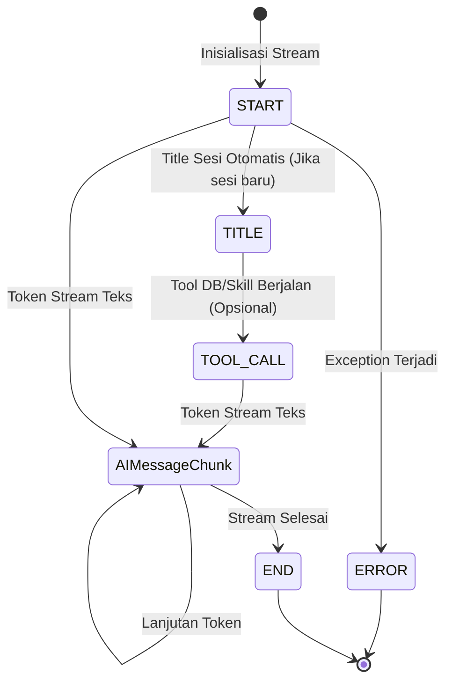

# Synchrono AI Chatbot — API Contract & Integration Guide

**Version:** 1.0.0  
**Target:** Frontend Website & Client Engineers  
**Protocol:** REST API + Server-Sent Events (SSE)  
**Base URL (Local/Dev):** `http://localhost:8000`  
**Base URL (Production):** `https://api-chatbot.synchrono.internal`

---

## 1. Overview Arsitektur Integrasi

Service Chatbot Synchrono disajikan sebagai API mandiri berbasis **FastAPI** yang melayani query data analitik, penjelasan kualitas pemadanan identitas, serta perutean link investigasi. 

Seluruh riwayat sesi percakapan disimpan secara persisten di database **PostgreSQL**, sementara jejak inferensi dievaluasi secara real-time melalui **Opik Cloud**.

```
┌─────────────────────────┐          POST /api/v1/chat (SSE Stream)         ┌─────────────────────────┐
│                         │ ──────────────────────────────────────────────► │                         │
│  Synchrono Web Frontend │                                                 │  Synchrono Chatbot API  │
│  (React / Next.js / Vue)│ ◄────────────────────────────────────────────── │  (FastAPI + PostgreSQL) │
│                         │        text/event-stream (JSON chunks)          │                         │
└─────────────────────────┘                                                 └─────────────────────────┘
```

---

## 2. Autentikasi & Headers

Semua request wajib menyertakan header standar:

| Header | Nilai | Keterangan |
| :--- | :--- | :--- |
| `Content-Type` | `application/json` | Wajib untuk request ber-body JSON |
| `Accept` | `text/event-stream` | Wajib untuk endpoint `/api/v1/chat` |
| `Authorization` | `Bearer <JWT_TOKEN>` | Token otentikasi user (opsional di dev, wajib di prod) |

---

## 3. Daftar Endpoint API

### 3.1. Stream Chatbot Response (SSE)
* **Endpoint:** `POST /api/v1/chat`
* **Content-Type:** `application/json`
* **Response Media Type:** `text/event-stream`

#### Request Payload Schema
```json
{
  "query": "Berikan summary dalam satu tahun terakhir?",
  "conversation_id": "conv-a1b2c3d4-uuid",
  "user_id": "usr_998124",
  "enable_pii": true,
  "model_name": null,
  "base_url": null
}
```

| Field | Tipe | Wajib? | Deskripsi |
| :--- | :--- | :--- | :--- |
| `query` | `string` | **Ya** | Teks pertanyaan pengguna (min 1 karakter). |
| `conversation_id` | `string` | **Ya** | ID sesi percakapan unik (disarankan format UUIDv4). |
| `user_id` | `string` | **Ya** | ID user yang sedang login untuk riwayat per-pengguna. |
| `enable_pii` | `boolean` | Tidak | Sensor otomatis NIK 16 digit (`default: true`). |
| `model_name` | `string` | Tidak | Override model tertentu (`null` = gunakan default server). |
| `base_url` | `string` | Tidak | Override LLM base URL endpoint. |

---

#### Server-Sent Events (SSE) Protocol Specification

Respons streaming dikirim dalam format standar SSE `data: <JSON>\n\n`. Klien frontend harus membaca event stream dan mengupdate antarmuka pengguna berdasarkan field `step`:



#### Macam-Macam Event Chunk `data: {...}`:

1. **`START`** — Menandakan koneksi stream dibuka:
   ```json
   data: {"step": "START", "content": ""}
   ```
2. **`TITLE`** — Mengirimkan judul percakapan ringkas otomatis (dihasilkan saat pesan pertama):
   ```json
   data: {"step": "TITLE", "content": "Ringkasan Data Satu Tahun"}
   ```
3. **`TOOL_CALL`** — Agen sedang mengeksekusi query database analitik atau memuat aturan domain:
   ```json
   data: {"step": "TOOL_CALL", "tool_calls": [{"name": "run_query"}], "content": "Sedang menjalankan analisis data..."}
   ```
4. **`AIMessageChunk`** — Potongan teks jawaban yang sedang di-*typewrite*:
   ```json
   data: {"step": "AIMessageChunk", "content": "Berdasarkan data 1 tahun terakhir, "}
   ```
5. **`END`** — Menandakan respons lengkap telah selesai dikirim:
   ```json
   data: {"step": "END", "content": "seluruh teks respons akhir..."}
   ```
6. **`ERROR`** — Terjadi kesalahan pada proses eksekusi:
   ```json
   data: {"step": "ERROR", "content": "Pesan deskripsi kesalahan"}
   ```

---

### 3.2. List Sesi Percakapan Pengguna
* **Endpoint:** `GET /api/v1/conversations`
* **Query Parameters:** `user_id=<user_id>` (wajib)

#### Response (HTTP 200 OK)
```json
[
  {
    "id": "conv-a1b2c3d4-uuid",
    "user_id": "usr_998124",
    "title": "Ringkasan Data Satu Tahun",
    "created_at": "2026-09-30T10:30:00Z",
    "updated_at": "2026-09-30T10:32:15Z"
  }
]
```

---

### 3.3. Ambil Pesan Dalam Sesi Tertentu
* **Endpoint:** `GET /api/v1/conversations/{conversation_id}`

#### Response (HTTP 200 OK)
```json
[
  {
    "id": "msg-001",
    "conversation_id": "conv-a1b2c3d4-uuid",
    "role": "human",
    "content": "Ada berapa banyak file yang institusinya fav institute?",
    "created_at": "2026-09-30T10:30:00Z"
  },
  {
    "id": "msg-002",
    "conversation_id": "conv-a1b2c3d4-uuid",
    "role": "ai",
    "content": "Berdasarkan database, terdapat **3 batch upload file** untuk Fav Institute dengan **2 nama file unik**.",
    "created_at": "2026-09-30T10:30:04Z"
  }
]
```

---

### 3.4. Hapus Sesi Percakapan
* **Endpoint:** `DELETE /api/v1/conversations/{conversation_id}`

#### Response (HTTP 200 OK)
```json
{
  "status": "success",
  "message": "Sesi conv-a1b2c3d4-uuid berhasil dihapus."
}
```

---

### 3.5. Health Check & Database Status
* **Endpoint:** `GET /api/v1/health`

#### Response (HTTP 200 OK)
```json
{
  "status": "healthy",
  "service": "synchrono-chatbot",
  "version": "1.0.0",
  "postgres_db": "localhost:5433/synchrono_chatbot",
  "analytics_db": "localhost:9030/synchrono",
  "model": "gemma4:31b-cloud"
}
```

---

## 4. Contoh Kode Integrasi Frontend (TypeScript)

Berikut snippet siap pakai untuk membaca stream SSE di frontend React / Next.js / Vue:

```typescript
export async function streamChatbotResponse(
  query: string,
  conversationId: string,
  userId: string,
  onChunk: (text: string) => void,
  onTitle?: (title: string) => void,
  onToolRunning?: () => void
): Promise<string> {
  const response = await fetch("http://localhost:8000/api/v1/chat", {
    method: "POST",
    headers: {
      "Content-Type": "application/json",
      "Accept": "text/event-stream",
    },
    body: JSON.stringify({
      query,
      conversation_id: conversationId,
      user_id: userId,
      enable_pii: true,
    }),
  });

  if (!response.ok || !response.body) {
    throw new Error(`Chat API error HTTP ${response.status}`);
  }

  const reader = response.body.getReader();
  const decoder = new TextDecoder("utf-8");
  let fullText = "";
  let buffer = "";

  while (true) {
    const { value, done } = await reader.read();
    if (done) break;

    buffer += decoder.decode(value, { stream: true });
    const lines = buffer.split("\n\n");
    buffer = lines.pop() ?? "";

    for (const line of lines) {
      if (!line.startsWith("data:")) continue;
      const rawJson = line.replace("data:", "").trim();
      if (!rawJson) continue;

      try {
        const payload = JSON.parse(rawJson);
        switch (payload.step) {
          case "TITLE":
            onTitle?.(payload.content);
            break;
          case "TOOL_CALL":
            onToolRunning?.();
            break;
          case "AIMessageChunk":
            fullText += payload.content;
            onChunk(fullText);
            break;
          case "ERROR":
            throw new Error(payload.content);
        }
      } catch (err) {
        console.warn("SSE chunk parse warning:", err);
      }
    }
  }

  return fullText;
}
```

---

## 5. Standar HTTP Error Codes

| Status Code | Kondisi | Format Response |
| :--- | :--- | :--- |
| `400 Bad Request` | Body query kosong atau schema tidak valid | `{"detail": "Pertanyaan tidak boleh kosong."}` |
| `404 Not Found` | ID percakapan tidak ditemukan saat hapus | `{"detail": "Sesi percakapan tidak ditemukan..."}` |
| `500 Server Error` | Gangguan database atau kegagalan pemanggilan LLM | `{"detail": "Gagal memproses pesan: <error>"}` |
