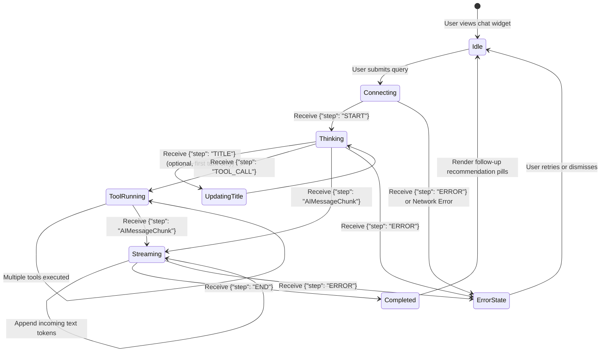

# Synchrono AI Chatbot: Production Frontend Integration Guide

> **STATUS: OUTDATED.** Untuk kontrak API aktual dan contoh React streaming, gunakan [`REACT_STREAMING_INTEGRATION.md`](./REACT_STREAMING_INTEGRATION.md). Dokumen ini masih memakai endpoint/field lama (`/api/v1/chat`, `query`, `conversation_id`) dan tidak sesuai implementasi saat ini.

> **Target Audience:** Frontend Engineers and AI Coding Agents  
> **Protocol:** Server-Sent Events (SSE) over HTTP POST + REST API  
> **Base URL (Local/Dev):** `http://localhost:8000`  
> **Base URL (Production):** `https://api-chatbot.synchrono.internal`  
> **Document Purpose:** Complete, drop-in technical specification for integrating the Synchrono Chatbot pop-up widget into the production web application.

---

## 1. Integration Topology & Overview

The Synchrono Chatbot provides real-time streaming data analytics, mismatch reasoning, and investigation links. The frontend interacts with the service using two primary channels:
1. **REST Endpoints:** For managing conversation sessions, message history, and service health checks.
2. **Server-Sent Events (SSE) via `POST /api/v1/chat`:** For streaming LLM generation, tool execution status, and session title updates.

```
+-----------------------------------+             POST /api/v1/chat (SSE Stream)            +------------------------------------+
|                                   | ----------------------------------------------------> |                                    |
|      Synchrono Web Frontend       |                                                       |        Synchrono Chatbot API       |
|    (React / Next.js / Vue / JS)   | <---------------------------------------------------- |        (FastAPI + PostgreSQL)      |
|                                   |            text/event-stream (JSON events)            |                                    |
|  - Manages Chat Widget State      |                                                       |  - LangGraph Reasoning Agent       |
|  - Renders Thinking Animations    | <===================================================> |  - Persists Sessions in PostgreSQL |
|  - Renders Interactive Pills      |             REST: /conversations, /health             |  - Strict Read-Only Analytics DB   |
+-----------------------------------+                                                       +------------------------------------+
```

---

## 2. API Endpoints Specification

### 2.1. Streaming Chat Endpoint (SSE)
* **Path:** `POST /api/v1/chat`
* **Headers:**
  ```http
  Content-Type: application/json
  Accept: text/event-stream
  Authorization: Bearer <JWT_TOKEN>
  ```
* **Request Body Schema (JSON):**
  ```json
  {
    "query": "Tampilkan data Budi",
    "conversation_id": "9b1deb4d-3b7d-4bad-9bdd-2b0d7b3dcb6d",
    "user_id": "usr_998124",
    "enable_pii": true,
    "model_name": null,
    "base_url": null
  }
  ```

| Field | Type | Required | Description |
|:---|:---|:---:|:---|
| `query` | `string` | **Yes** | User input question (minimum 1 character). |
| `conversation_id` | `string` | **Yes** | Unique conversation session ID. Must be formatted as UUIDv4. |
| `user_id` | `string` | **Yes** | Identifier of the authenticated user. |
| `enable_pii` | `boolean` | No | Enables server-side masking for 16-digit NIKs (default: `true`). |
| `model_name` | `string` or `null` | No | Optional LLM override (pass `null` to use server default). |
| `base_url` | `string` or `null` | No | Optional base URL override (pass `null` to use server default). |

---

### 2.2. Conversation Management Endpoints

#### List User Conversations
* **Method:** `GET /api/v1/conversations?user_id={user_id}`
* **Response (HTTP 200 OK):**
  ```json
  [
    {
      "id": "9b1deb4d-3b7d-4bad-9bdd-2b0d7b3dcb6d",
      "user_id": "usr_998124",
      "title": "Analisis Data Budi",
      "created_at": "2026-10-01T10:30:00Z",
      "updated_at": "2026-10-01T10:32:15Z"
    }
  ]
  ```

#### Fetch Conversation Messages
* **Method:** `GET /api/v1/conversations/{conversation_id}`
* **Response (HTTP 200 OK):**
  ```json
  [
    {
      "id": "msg_001",
      "conversation_id": "9b1deb4d-3b7d-4bad-9bdd-2b0d7b3dcb6d",
      "role": "human",
      "content": "Tampilkan data Budi",
      "created_at": "2026-10-01T10:30:00Z"
    },
    {
      "id": "msg_002",
      "conversation_id": "9b1deb4d-3b7d-4bad-9bdd-2b0d7b3dcb6d",
      "role": "ai",
      "content": "Ditemukan 2 kandidat bernama Budi...",
      "created_at": "2026-10-01T10:30:04Z"
    }
  ]
  ```

#### Delete Conversation
* **Method:** `DELETE /api/v1/conversations/{conversation_id}`
* **Response (HTTP 200 OK):**
  ```json
  {
    "status": "success",
    "message": "Sesi 9b1deb4d-3b7d-4bad-9bdd-2b0d7b3dcb6d berhasil dihapus."
  }
  ```

#### Health Check
* **Method:** `GET /api/v1/health`
* **Response (HTTP 200 OK):**
  ```json
  {
    "status": "healthy",
    "service": "synchrono-chatbot",
    "version": "1.0.0",
    "postgres_db": "localhost:5433/synchrono_chatbot",
    "analytics_db": "localhost:9030/synchrono",
    "model": "gemma4:31b-cloud"
  }
  ```

---

## 3. Server-Sent Events (SSE) Wire Protocol & UI State Machine

Streaming responses arrive as chunks in standard SSE format: `data: <JSON>\n\n`. The frontend client must read the stream buffer, parse each JSON payload, and update the UI based on the `step` field.



### Event Payload Definitions

1. **`START`** (Stream Opened):
   ```json
   data: {"step": "START", "content": ""}
   ```
   *Action:* Create an active AI message bubble in `is-thinking` state. Display animated loading dots.

2. **`TITLE`** (Auto-Generated Session Title):
   ```json
   data: {"step": "TITLE", "content": "Analisis Data Budi"}
   ```
   *Action:* Update the conversation header in the sidebar or widget title.

3. **`TOOL_CALL`** (Analytical Query Execution):
   ```json
   data: {
     "step": "TOOL_CALL",
     "tool_calls": [{"name": "run_query", "args": {"query": "SELECT ..."}}],
     "content": "Sedang menganalisis database Synchrono..."
   }
   ```
   *Action:* Update status text inside the thinking bubble to indicate backend progress (e.g., *"Menganalisis database..."* or *"Mengeksekusi query..."*).

4. **`AIMessageChunk`** (Text Token Stream):
   ```json
   data: {"step": "AIMessageChunk", "content": "Berdasarkan data pencocokan, "}
   ```
   *Action:* Transition the bubble from `is-thinking` to active markdown rendering. Append the chunk to the message content.

5. **`END`** (Stream Finished):
   ```json
   data: {"step": "END", "content": "<Full accumulated response text>"}
   ```
   *Action:* Mark message streaming as complete. Parse any contextual follow-up recommendations and display interactive buttons.

6. **`ERROR`** (Execution Failure):
   ```json
   data: {"step": "ERROR", "content": "Gagal terhubung ke database analitik."}
   ```
   *Action:* Display the error message in the bubble with a retry button.

---

## 4. Frontend UX Requirements & Best Practices

### 4.1. Resolving the "Empty Black Box" Artifact
When the server sends `START` or `TOOL_CALL`, the assistant has not emitted text tokens yet. 

**Anti-Slop Requirement:**
* Do NOT render an empty dark container or hollow bubble.
* Render a subtle, pulsing thinking badge with animated dots (`...`) and the dynamic tool status (e.g. *"Sedang menganalisis database Synchrono..."*).
* As soon as the first `AIMessageChunk` arrives, immediately replace the thinking status text with the incoming text tokens.

### 4.2. Rendering Dynamic Follow-Up Recommendation Pills
When an ambiguous query is processed (e.g., *"Tampilkan data Budi"*), the agent ends its answer with structured follow-up suggestions, formatted as a markdown bullet list:

```markdown
Rekomendasi pertanyaan lanjutan yang dapat Anda pilih:
* Cek detail peninjauan manual Budi Santoso
* Periksa riwayat pencocokan Budi Setiawan
* Tampilkan statistik grade file terkait
```

**Parsing & Rendering Pattern:**
1. Detect lines starting with `* ` or `- ` under the recommendation header.
2. Render these items as interactive badge buttons (pills) beneath the bubble.
3. Clicking a pill automatically populates the chat input field or immediately submits the follow-up question.

---

## 5. Production Integration Templates

### Template A: React / Next.js Integration (TypeScript + Tailwind CSS)

#### 1. Custom Hook: `hooks/useSynchronoChat.ts`
```typescript
import { useState, useCallback, useRef } from "react";

export interface ChatMessage {
  id: string;
  role: "human" | "ai";
  content: string;
  isStreaming?: boolean;
  isThinking?: boolean;
  statusText?: string;
  recommendations?: string[];
}

interface UseSynchronoChatOptions {
  apiBaseUrl?: string;
  userId: string;
  conversationId: string;
  authToken?: string;
}

export function useSynchronoChat({
  apiBaseUrl = "http://localhost:8000",
  userId,
  conversationId,
  authToken,
}: UseSynchronoChatOptions) {
  const [messages, setMessages] = useState<ChatMessage[]>([]);
  const [isLoading, setIsLoading] = useState(false);
  const abortControllerRef = useRef<AbortController | null>(null);

  // Helper to extract recommendation bullet points
  const extractRecommendations = (text: string): string[] => {
    const lines = text.split("\n");
    const recs: string[] = [];
    let isRecSection = false;

    for (const line of lines) {
      const lower = line.toLowerCase();
      if (lower.includes("rekomendasi") || lower.includes("pertanyaan lanjutan")) {
        isRecSection = true;
        continue;
      }
      if (isRecSection && (line.trim().startsWith("* ") || line.trim().startsWith("- "))) {
        recs.push(line.trim().replace(/^[\*\-]\s+/, ""));
      }
    }
    return recs;
  };

  const sendMessage = useCallback(
    async (queryText: string) => {
      if (!queryText.trim() || isLoading) return;

      const userMsgId = `user_${Date.now()}`;
      const aiMsgId = `ai_${Date.now()}`;

      // 1. Append user message
      const userMessage: ChatMessage = {
        id: userMsgId,
        role: "human",
        content: queryText,
      };

      // 2. Append temporary thinking bubble for AI
      const initialAiMessage: ChatMessage = {
        id: aiMsgId,
        role: "ai",
        content: "",
        isStreaming: true,
        isThinking: true,
        statusText: "Menghubungkan ke asisten analitik...",
      };

      setMessages((prev) => [...prev, userMessage, initialAiMessage]);
      setIsLoading(true);

      const abortController = new AbortController();
      abortControllerRef.current = abortController;

      try {
        const headers: Record<string, string> = {
          "Content-Type": "application/json",
          "Accept": "text/event-stream",
        };
        if (authToken) {
          headers["Authorization"] = `Bearer ${authToken}`;
        }

        const response = await fetch(`${apiBaseUrl}/api/v1/chat`, {
          method: "POST",
          headers,
          body: JSON.stringify({
            query: queryText,
            conversation_id: conversationId,
            user_id: userId,
            enable_pii: true,
          }),
          signal: abortController.signal,
        });

        if (!response.ok || !response.body) {
          throw new Error(`HTTP error ${response.status}: ${response.statusText}`);
        }

        const reader = response.body.getReader();
        const decoder = new TextDecoder("utf-8");
        let accumulatedText = "";
        let buffer = "";

        while (true) {
          const { value, done } = await reader.read();
          if (done) break;

          buffer += decoder.decode(value, { stream: true });
          const parts = buffer.split("\n\n");
          buffer = parts.pop() ?? "";

          for (const part of parts) {
            const trimmed = part.trim();
            if (!trimmed.startsWith("data:")) continue;

            const jsonStr = trimmed.replace(/^data:\s*/, "").trim();
            if (!jsonStr) continue;

            try {
              const event = JSON.parse(jsonStr);

              switch (event.step) {
                case "START":
                  setMessages((prev) =>
                    prev.map((msg) =>
                      msg.id === aiMsgId
                        ? { ...msg, statusText: "Menganalisis pertanyaan..." }
                        : msg
                    )
                  );
                  break;

                case "TOOL_CALL":
                  setMessages((prev) =>
                    prev.map((msg) =>
                      msg.id === aiMsgId
                        ? {
                            ...msg,
                            statusText: event.content || "Mengeksekusi query database...",
                          }
                        : msg
                    )
                  );
                  break;

                case "AIMessageChunk":
                  accumulatedText += event.content || "";
                  setMessages((prev) =>
                    prev.map((msg) =>
                      msg.id === aiMsgId
                        ? {
                            ...msg,
                            isThinking: false,
                            content: accumulatedText,
                            statusText: undefined,
                          }
                        : msg
                    )
                  );
                  break;

                case "END":
                  const finalRecs = extractRecommendations(accumulatedText);
                  setMessages((prev) =>
                    prev.map((msg) =>
                      msg.id === aiMsgId
                        ? {
                            ...msg,
                            isStreaming: false,
                            isThinking: false,
                            content: accumulatedText,
                            recommendations: finalRecs,
                          }
                        : msg
                    )
                  );
                  break;

                case "ERROR":
                  setMessages((prev) =>
                    prev.map((msg) =>
                      msg.id === aiMsgId
                        ? {
                            ...msg,
                            isStreaming: false,
                            isThinking: false,
                            content: `Terjadi kesalahan: ${event.content}`,
                          }
                        : msg
                    )
                  );
                  break;
              }
            } catch (err) {
              console.warn("SSE parse error:", err);
            }
          }
        }
      } catch (err: any) {
        if (err.name === "AbortError") {
          console.log("Chat stream aborted by user.");
        } else {
          setMessages((prev) =>
            prev.map((msg) =>
              msg.id === aiMsgId
                ? {
                    ...msg,
                    isStreaming: false,
                    isThinking: false,
                    content: `Gagal memproses pesan: ${err.message}`,
                  }
                : msg
            )
          );
        }
      } finally {
        setIsLoading(false);
        abortControllerRef.current = null;
      }
    },
    [apiBaseUrl, conversationId, userId, authToken, isLoading]
  );

  const abortStream = useCallback(() => {
    if (abortControllerRef.current) {
      abortControllerRef.current.abort();
    }
  }, []);

  return { messages, sendMessage, isLoading, abortStream, setMessages };
}
```

---

#### 2. Chat Widget Component: `components/ChatWidget.tsx`
```tsx
import React, { useState, useRef, useEffect } from "react";
import { useSynchronoChat } from "../hooks/useSynchronoChat";
import ReactMarkdown from "react-markdown";

interface ChatWidgetProps {
  userId: string;
  conversationId: string;
  apiBaseUrl?: string;
}

export const ChatWidget: React.FC<ChatWidgetProps> = ({
  userId,
  conversationId,
  apiBaseUrl,
}) => {
  const [isOpen, setIsOpen] = useState(false);
  const [input, setInput] = useState("");
  const messagesEndRef = useRef<HTMLDivElement>(null);

  const { messages, sendMessage, isLoading, abortStream } = useSynchronoChat({
    userId,
    conversationId,
    apiBaseUrl,
  });

  const scrollToBottom = () => {
    messagesEndRef.current?.scrollIntoView({ behavior: "smooth" });
  };

  useEffect(() => {
    scrollToBottom();
  }, [messages]);

  const handleSubmit = (e: React.FormEvent) => {
    e.preventDefault();
    if (!input.trim() || isLoading) return;
    sendMessage(input);
    setInput("");
  };

  const handleRecommendationClick = (promptText: string) => {
    sendMessage(promptText);
  };

  return (
    <div className="fixed bottom-6 right-6 z-50 font-sans">
      {/* Pop-up Trigger Button */}
      {!isOpen && (
        <button
          onClick={() => setIsOpen(true)}
          className="flex items-center gap-2 px-5 py-3 rounded-full bg-blue-600 hover:bg-blue-700 text-white font-medium shadow-lg hover:shadow-xl transition-all"
        >
          <svg className="w-5 h-5" fill="none" stroke="currentColor" viewBox="0 0 24 24">
            <path strokeLinecap="round" strokeLinejoin="round" strokeWidth={2} d="M8 10h.01M12 10h.01M16 10h.01M21 12c0 4.418-4.03 8-9 8a9.863 9.863 0 01-4.255-.949L3 20l1.395-3.72C3.512 15.042 3 13.574 3 12c0-4.418 4.03-8 9-8s9 3.582 9 8z" />
          </svg>
          Asisten Synchrono
        </button>
      )}

      {/* Chat Window Container */}
      {isOpen && (
        <div className="w-96 sm:w-[440px] h-[580px] bg-white rounded-2xl shadow-2xl flex flex-col border border-gray-200 overflow-hidden">
          {/* Header */}
          <div className="px-5 py-4 bg-gray-900 text-white flex items-center justify-between">
            <div className="flex items-center gap-3">
              <span className="w-2.5 h-2.5 rounded-full bg-emerald-400 animate-pulse" />
              <div>
                <h3 className="font-semibold text-sm">Synchrono Data Analyst</h3>
                <p className="text-xs text-gray-400">Identity-Matching Assistant</p>
              </div>
            </div>
            <button
              onClick={() => setIsOpen(false)}
              className="text-gray-400 hover:text-white transition"
              aria-label="Tutup Chat"
            >
              <svg className="w-5 h-5" fill="none" stroke="currentColor" viewBox="0 0 24 24">
                <path strokeLinecap="round" strokeLinejoin="round" strokeWidth={2} d="M6 18L18 6M6 6l12 12" />
              </svg>
            </button>
          </div>

          {/* Messages Area */}
          <div className="flex-1 p-4 overflow-y-auto space-y-4 bg-gray-50">
            {messages.length === 0 && (
              <div className="text-center py-12 text-gray-400 text-sm">
                Ajukan pertanyaan tentang status batch, distribusi grade, atau riwayat pencocokan identitas.
              </div>
            )}

            {messages.map((msg) => (
              <div
                key={msg.id}
                className={`flex flex-col ${msg.role === "human" ? "items-end" : "items-start"}`}
              >
                <div
                  className={`max-w-[85%] rounded-2xl px-4 py-3 text-sm leading-relaxed ${
                    msg.role === "human"
                      ? "bg-blue-600 text-white rounded-br-none shadow-sm"
                      : "bg-white text-gray-800 border border-gray-200 rounded-bl-none shadow-sm"
                  }`}
                >
                  {/* Thinking Status Indicator */}
                  {msg.isThinking ? (
                    <div className="flex items-center gap-2 text-gray-500 py-1">
                      <span className="flex space-x-1">
                        <span className="w-2 h-2 bg-blue-500 rounded-full animate-bounce [animation-delay:-0.3s]" />
                        <span className="w-2 h-2 bg-blue-500 rounded-full animate-bounce [animation-delay:-0.15s]" />
                        <span className="w-2 h-2 bg-blue-500 rounded-full animate-bounce" />
                      </span>
                      <span className="text-xs italic">{msg.statusText}</span>
                    </div>
                  ) : (
                    <div className="prose prose-sm max-w-none break-words">
                      <ReactMarkdown>{msg.content}</ReactMarkdown>
                    </div>
                  )}
                </div>

                {/* Contextual Recommendation Pills */}
                {msg.role === "ai" && msg.recommendations && msg.recommendations.length > 0 && (
                  <div className="mt-2.5 flex flex-wrap gap-1.5 max-w-[90%]">
                    {msg.recommendations.map((rec, idx) => (
                      <button
                        key={idx}
                        onClick={() => handleRecommendationClick(rec)}
                        disabled={isLoading}
                        className="text-xs px-3 py-1.5 bg-blue-50 hover:bg-blue-100 text-blue-700 rounded-full border border-blue-200 transition font-medium text-left"
                      >
                        {rec}
                      </button>
                    ))}
                  </div>
                )}
              </div>
            ))}
            <div ref={messagesEndRef} />
          </div>

          {/* Input Footer */}
          <form onSubmit={handleSubmit} className="p-3 bg-white border-t border-gray-200 flex gap-2">
            <input
              type="text"
              value={input}
              onChange={(e) => setInput(e.target.value)}
              placeholder="Tanyakan analisis data..."
              disabled={isLoading}
              className="flex-1 px-4 py-2 border border-gray-300 rounded-xl text-sm focus:outline-none focus:ring-2 focus:ring-blue-500 disabled:bg-gray-100"
            />
            {isLoading ? (
              <button
                type="button"
                onClick={abortStream}
                className="px-4 py-2 bg-amber-500 hover:bg-amber-600 text-white rounded-xl text-sm font-medium transition"
              >
                Stop
              </button>
            ) : (
              <button
                type="submit"
                disabled={!input.trim()}
                className="px-4 py-2 bg-blue-600 hover:bg-blue-700 disabled:bg-gray-300 text-white rounded-xl text-sm font-medium transition"
              >
                Kirim
              </button>
            )}
          </form>
        </div>
      )}
    </div>
  );
};
```

---

### Template B: Vue 3 / Nuxt 3 Integration (Composition API)

#### Composable: `composables/useChatbot.ts`
```typescript
import { ref } from 'vue';

export interface Message {
  id: string;
  role: 'human' | 'ai';
  content: string;
  isThinking?: boolean;
  statusText?: string;
  recommendations?: string[];
}

export function useChatbot(apiBaseUrl: string = 'http://localhost:8000') {
  const messages = ref<Message[]>([]);
  const isLoading = ref(false);
  let abortController: AbortController | null = null;

  const parseRecommendations = (text: string): string[] => {
    const lines = text.split('\n');
    const items: string[] = [];
    let isRec = false;
    for (const line of lines) {
      if (line.toLowerCase().includes('rekomendasi')) {
        isRec = true;
        continue;
      }
      if (isRec && (line.trim().startsWith('* ') || line.trim().startsWith('- '))) {
        items.push(line.trim().replace(/^[\*\-]\s+/, ''));
      }
    }
    return items;
  };

  const sendQuery = async (query: string, conversationId: string, userId: string) => {
    if (!query.trim() || isLoading.value) return;

    const userMsg: Message = { id: `u_${Date.now()}`, role: 'human', content: query };
    const aiMsg: Message = {
      id: `a_${Date.now()}`,
      role: 'ai',
      content: '',
      isThinking: true,
      statusText: 'Sedang memproses...',
    };

    messages.value.push(userMsg, aiMsg);
    isLoading.value = true;
    abortController = new AbortController();

    try {
      const response = await fetch(`${apiBaseUrl}/api/v1/chat`, {
        method: 'POST',
        headers: {
          'Content-Type': 'application/json',
          'Accept': 'text/event-stream',
        },
        body: JSON.stringify({
          query,
          conversation_id: conversationId,
          user_id: userId,
          enable_pii: true,
        }),
        signal: abortController.signal,
      });

      if (!response.ok || !response.body) throw new Error(`HTTP ${response.status}`);

      const reader = response.body.getReader();
      const decoder = new TextDecoder();
      let buffer = '';
      let accumulated = '';

      while (true) {
        const { value, done } = await reader.read();
        if (done) break;

        buffer += decoder.decode(value, { stream: true });
        const lines = buffer.split('\n\n');
        buffer = lines.pop() ?? '';

        for (const line of lines) {
          if (!line.trim().startsWith('data:')) continue;
          const json = JSON.parse(line.trim().replace(/^data:\s*/, ''));

          const target = messages.value.find((m) => m.id === aiMsg.id);
          if (!target) continue;

          if (json.step === 'TOOL_CALL') {
            target.statusText = json.content || 'Mengeksekusi analisis database...';
          } else if (json.step === 'AIMessageChunk') {
            target.isThinking = false;
            accumulated += json.content;
            target.content = accumulated;
          } else if (json.step === 'END') {
            target.isThinking = false;
            target.content = accumulated;
            target.recommendations = parseRecommendations(accumulated);
          }
        }
      }
    } catch (err: any) {
      if (err.name !== 'AbortError') {
        const target = messages.value.find((m) => m.id === aiMsg.id);
        if (target) target.content = `Error: ${err.message}`;
      }
    } finally {
      isLoading.value = false;
    }
  };

  const cancel = () => {
    if (abortController) abortController.abort();
  };

  return { messages, isLoading, sendQuery, cancel };
}
```

---

### Template C: Vanilla JavaScript / Zero-Dependency Web Component

For projects using traditional HTML/PHP, Blade, or Django templates, copy the following single script to embed the chat assistant with zero dependencies:

```html
<script>
class SynchronoChatWidget extends HTMLElement {
  connectedCallback() {
    this.apiUrl = this.getAttribute('api-url') || 'http://localhost:8000';
    this.userId = this.getAttribute('user-id') || 'guest_user';
    this.conversationId = this.getAttribute('conversation-id') || crypto.randomUUID();

    this.innerHTML = `
      <style>
        .synchrono-fab { position: fixed; bottom: 24px; right: 24px; z-index: 9999; background: #2563eb; color: #fff; border: none; border-radius: 999px; padding: 12px 20px; font-family: sans-serif; cursor: pointer; font-weight: 600; box-shadow: 0 10px 25px rgba(0,0,0,0.15); }
        .synchrono-panel { display: none; position: fixed; bottom: 80px; right: 24px; width: 380px; height: 520px; background: #fff; border: 1px solid #e5e7eb; border-radius: 16px; box-shadow: 0 20px 40px rgba(0,0,0,0.18); flex-direction: column; overflow: hidden; font-family: sans-serif; z-index: 9999; }
        .synchrono-header { background: #0f172a; color: #fff; padding: 14px 18px; font-weight: 600; font-size: 14px; }
        .synchrono-msgs { flex: 1; overflow-y: auto; padding: 14px; background: #f8fafc; font-size: 13px; line-height: 1.5; }
        .synchrono-bubble { margin-bottom: 10px; padding: 10px 14px; border-radius: 12px; max-width: 82%; }
        .synchrono-user { background: #2563eb; color: #fff; margin-left: auto; border-bottom-right-radius: 2px; }
        .synchrono-ai { background: #fff; color: #1e293b; border: 1px solid #e2e8f0; border-bottom-left-radius: 2px; }
        .synchrono-footer { display: flex; padding: 10px; border-top: 1px solid #e2e8f0; background: #fff; }
        .synchrono-input { flex: 1; border: 1px solid #cbd5e1; border-radius: 8px; padding: 8px 12px; font-size: 13px; outline: none; }
        .synchrono-send { background: #2563eb; color: #fff; border: none; border-radius: 8px; padding: 8px 14px; margin-left: 8px; cursor: pointer; font-size: 13px; }
        .synchrono-pill { display: inline-block; background: #eff6ff; color: #1d4ed8; border: 1px solid #bfdbfe; border-radius: 999px; padding: 4px 10px; margin: 3px; cursor: pointer; font-size: 11px; }
      </style>
      <button class="synchrono-fab" id="sc-toggle">💬 Asisten Synchrono</button>
      <div class="synchrono-panel" id="sc-panel">
        <div class="synchrono-header">Synchrono Data Analyst</div>
        <div class="synchrono-msgs" id="sc-msgs"></div>
        <div class="synchrono-footer">
          <input type="text" class="synchrono-input" id="sc-input" placeholder="Tanyakan data..." />
          <button class="synchrono-send" id="sc-send">Kirim</button>
        </div>
      </div>
    `;

    const panel = this.querySelector('#sc-panel');
    const toggle = this.querySelector('#sc-toggle');
    const send = this.querySelector('#sc-send');
    const input = this.querySelector('#sc-input');
    const msgs = this.querySelector('#sc-msgs');

    toggle.onclick = () => {
      panel.style.display = panel.style.display === 'flex' ? 'none' : 'flex';
    };

    const submit = async (text) => {
      if (!text.trim()) return;
      msgs.innerHTML += `<div class="synchrono-bubble synchrono-user">${text}</div>`;
      input.value = '';
      msgs.scrollTop = msgs.scrollHeight;

      const aiBox = document.createElement('div');
      aiBox.className = 'synchrono-bubble synchrono-ai';
      aiBox.innerText = 'Menganalisis...';
      msgs.appendChild(aiBox);
      msgs.scrollTop = msgs.scrollHeight;

      try {
        const res = await fetch(`${this.apiUrl}/api/v1/chat`, {
          method: 'POST',
          headers: { 'Content-Type': 'application/json', 'Accept': 'text/event-stream' },
          body: JSON.stringify({ query: text, conversation_id: this.conversationId, user_id: this.userId })
        });
        const reader = res.body.getReader();
        const decoder = new TextDecoder();
        let buffer = '', full = '';

        while (true) {
          const { value, done } = await reader.read();
          if (done) break;
          buffer += decoder.decode(value, { stream: true });
          const parts = buffer.split('\n\n');
          buffer = parts.pop() || '';
          for (const p of parts) {
            if (!p.trim().startsWith('data:')) continue;
            const data = JSON.parse(p.replace(/^data:\s*/, ''));
            if (data.step === 'AIMessageChunk') {
              if (aiBox.innerText === 'Menganalisis...') aiBox.innerText = '';
              full += data.content;
              aiBox.innerText = full;
              msgs.scrollTop = msgs.scrollHeight;
            }
          }
        }
      } catch (e) {
        aiBox.innerText = 'Terjadi kesalahan sistem.';
      }
    };

    send.onclick = () => submit(input.value);
    input.onkeydown = (e) => { if (e.key === 'Enter') submit(input.value); };
  }
}
customElements.define('synchrono-chat-widget', SynchronoChatWidget);
</script>

<!-- Drop-in usage -->
<synchrono-chat-widget 
  api-url="https://api-chatbot.synchrono.internal" 
  user-id="usr_demo_123">
</synchrono-chat-widget>
```

---

## 6. Frontend Verification & Handover Checklist

Before shipping the chatbot widget to production, ensure the implementing developer or AI agent verifies each item below:

- [ ] **UUID Conversation Generation:** The frontend generates or retrieves a valid UUIDv4 string for `conversation_id`.
- [ ] **SSE Event Processing:** The client properly recognizes all 6 events (`START`, `TITLE`, `TOOL_CALL`, `AIMessageChunk`, `END`, `ERROR`).
- [ ] **Empty Black Box Prevention:** When `START` or `TOOL_CALL` is received, an animated thinking indicator is rendered instead of an empty box.
- [ ] **Dynamic Recommendation Pills:** Contextual follow-up suggestions generated at the end of responses are parsed and rendered as clickable action buttons.
- [ ] **Stream Cancellation:** The `AbortController` cleanly terminates streaming if the user cancels or closes the chat window.
- [ ] **CORS Configuration:** `CORS_ORIGINS` in `.env` includes the production domain (e.g., `["https://app.synchrono.internal"]`).
- [ ] **Token Sanitization:** User NIK inputs are masked client-side or safely passed with `enable_pii: true`.
